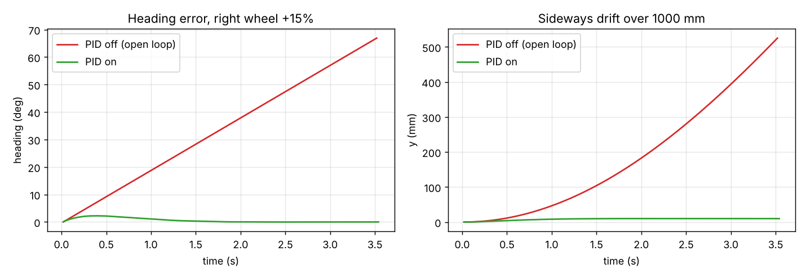

## 1. Scope

This report documents the motion-control subsystem of the occupancy-mapping rover: the differential-drive
kinematics, PWM motor control through the L293D, dead-reckoning pose estimation, drift compensation and the
PID heading controller. It covers the deliverable items "firmware documentation" and "kinematics analysis"
for the motion part of the project. Source: `firmware/motion/motion.ino`.

## 2. Hardware and model parameters

| Item | Value |
|---|---|
| Controller | Arduino Uno R3 (ATmega328P) |
| Driver | L293D H-bridge, separate 9V motor supply, common ground, 100 uF capacitor across Vcc2 and GND |
| Motors | 2 DC gear motors (differential drive) |
| Wheel diameter D | 65 mm |
| Wheel base L (centre to centre) | 120 mm |
| Motor speed at full PWM | 100 rpm |
| Cruising PWM | 200 / 255 |

Pins: left motor EN/IN1/IN2 = 5/4/7, right motor EN/IN3/IN4 = 6/8/12. Pins 2, 9, 10 are reserved for the
ultrasonic echo interrupt and the scanning servo.

## 3. Differential-drive kinematics

Wheel linear speed from the PWM command `p` (0 to 255):

```
v_wheel = (rpm_max / 60) * pi * D * (p / 255)
```

At p = 200: v = (100/60) * pi * 65 * (200/255) = **266.9 mm/s**.

Let `vL` and `vR` be the left and right wheel speeds. The rover body motion is:

```
v     = (vR + vL) / 2            forward speed of the chassis centre
omega = (vR - vL) / L            yaw rate (positive = counter-clockwise, left)
R     = (L / 2) * (vR + vL) / (vR - vL)   radius of curvature
```

Motion modes implemented:

| Mode | Wheel commands | Result at PWM 200 |
|---|---|---|
| Forward / reverse | vL = vR = +/- v | v = +/- 266.9 mm/s, omega = 0 |
| Tank turn (spin in place) | vL = -v, vR = +v | omega = 2v / L = 4.45 rad/s = **254.9 deg/s**, R = 0 |
| Pivot (one wheel stopped) | vL = 0, vR = v | omega = v / L = 2.22 rad/s = **127.4 deg/s**, centre speed 133.5 mm/s, R = L/2 = 60 mm |

Open-loop time estimates: 1000 mm straight = 3.75 s; an ideal 90 degree tank turn = 0.35 s.

## 4. Dead-reckoning pose estimate

Every 20 ms the firmware integrates the wheel speeds (Euler integration, heading 0 along +x):

```
theta += omega * dt
x     += v * cos(theta) * dt
y     += v * sin(theta) * dt
```

The pose `(x, y, theta)` in mm and radians is exposed through `getPose()` so the mapping module (M4) can place
ultrasonic scan points in a fixed world frame: `px = x + r*cos(theta + a)`, `py = y + r*sin(theta + a)`.

Error sources in a real robot are wheel slip, wheel diameter and wheel base tolerance, and integration error.
These grow without bound, which is why the project is called SLAM-*inspired*: the map is only locally accurate.

## 5. Drift and static trim compensation

Motor and wheel mismatch is modelled as a factor `f` on the right wheel speed (potentiometer on A0, 0.85 to
1.15). Open-loop, a straight command then produces a constant yaw rate
`omega = (f - 1) * v / L`; for f = 1.15 this is 0.33 rad/s (19 deg/s), so the rover curves away quickly.

Static trim multiplies a wheel command by a constant: `RIGHT_TRIM = 1 / f` cancels the mismatch exactly.

| Right wheel factor f | Open-loop after 1000 mm: y (mm) | Heading (deg) | Trim 1/f |
|---|---|---|---|
| 1.00 | 0.6 | 0.1 | 1.000 |
| 1.10 | 381.4 | 45.7 | 0.909 |
| 1.15 | 525.4 | 66.9 | 0.870 |
| 0.85 | -583.7 | -77.6 | 1.176 |

With `RIGHT_TRIM = 0.870` and f = 1.15, open-loop drift falls to 0.0 mm and 0.0 degrees. In practice f is not
known in advance and varies with load, so a feedback controller is also needed.

## 6. PID heading controller

**Structure.** For a straight move the target heading is the heading at the start. The steering correction `u`
is applied differentially: `left = base - u`, `right = base + u`.

```
e   = wrap(theta_target - theta)
I  += e * dt                                (clamped so that |KI * I| <= I_MAX)
u   = KP*e + KI*I - KD*(d theta / dt)       (derivative on measurement, |u| <= U_MAX)
```

Design choices:

- **Derivative on measurement** avoids a kick when the target changes.
- **Integrator clamp (anti-windup)** limits the integral contribution to 40 PWM counts, and the stored
  integrator is clamped as well, so it cannot wind up during saturation.
- **Output limit** of 80 PWM counts keeps one wheel from reversing during a straight move.
- **Control period** is 20 ms from `millis()`; there is no `delay()` anywhere.

**Tuning.** Gains were swept offline using a 1000 mm run with f = 1.15 and a 3000 mm run with f stepping from
1.00 to 1.15 after 1 s.

| KP | KI | KD | Sideways drift over 1000 mm (mm) | Peak heading error after step (deg) | Time to stay within 1 deg (ms) |
|---|---|---|---|---|---|
| 200 | 60 | 12 | 42.7 | 3.42 | 4839 |
| 200 | 150 | 12 | 25.5 | 3.02 | 2179 |
| 200 | 250 | 12 | 15.9 | 2.79 | 1419 |
| 250 | 250 | 12 | 15.8 | 2.41 | 1419 |
| **250** | **400** | **12** | **9.9** | **2.24** | **1019** |
| 300 | 400 | 20 | 9.9 | 1.91 | 1019 |

Selected: **KP = 250, KI = 400, KD = 12**. The integral term is what removes the steady offset; the very low
KI values leave a heading error for several seconds. Higher KP lowers the peak error slightly but gains
little beyond 250 and raises sensitivity to noise on real hardware.



## 7. Test results

All results below come from running the actual `motion.ino` control logic with the software plant at a 1 ms
simulation step. They should be repeated in Tinkercad (Section 9) and compared.

**Straight line, 1000 mm, PID on against off.**

| Right wheel factor f | PID | Final x (mm) | Final y (mm) | Final heading (deg) | Time (ms) |
|---|---|---|---|---|---|
| 1.00 | off | 1003.7 | 0.6 | 0.07 | 3780 |
| 1.10 | off | 899.6 | 381.4 | 45.69 | 3600 |
| 1.15 | off | 789.4 | 525.4 | 66.91 | 3520 |
| 0.85 | off | 720.8 | -583.7 | -77.62 | 4080 |
| 1.00 | on | 1001.2 | 0.1 | 0.01 | 3780 |
| 1.10 | on | 1004.2 | 6.9 | 0.00 | 3620 |
| 1.15 | on | 1002.5 | 9.9 | 0.01 | 3540 |
| 0.85 | on | 1003.0 | -9.9 | 0.00 | 4120 |

The PID removes more than 98 percent of the sideways error in every case, and the final heading returns to zero.

**Disturbance step.** f changes from 1.00 to 1.15 while driving: peak heading error 2.24 degrees, back within
1 degree after about 1.0 s, final heading 0.00 degrees.

**In-place turns (target tolerance 1.5 degrees).**

| Commanded turn | Final heading (deg) | Duration (ms) |
|---|---|---|
| +90 | 89.85 | 740 |
| -90 | -89.94 | 740 |
| +45 | 44.56 | 520 |
| 180 | -178.95 (that is 181.05) | 1080 |

**Square path (4 x 500 mm legs with 90 degree turns), PID on, no trim.**

| Right wheel factor f | Closure error at start point (mm) | Final heading error (deg) |
|---|---|---|
| 1.00 | 1.7 | -0.27 |
| 1.10 | 9.8 | -1.57 |

The rover returns to within 10 mm of its start after a 2 m loop even with a 10 percent wheel mismatch.

## 8. Stress tests and limitations

- **Worst drift tested:** f = 0.85 and 1.15 (15 percent mismatch). The PID keeps y within 10 mm per metre.
- **Output saturation:** `U_MAX = 80` caps correction. A mismatch above roughly 30 percent would saturate it
  and leave a residual drift; trim should then be adjusted.
- **Minimum PWM:** very low PWM stalls real motors. The code limits turning to a floor of 60 PWM.
- **Turn tolerance:** turns stop within 1.5 degrees; residuals add up over many turns, which is why the square
  path ends with a small heading error.
- **Simulation limitation:** Tinkercad has no physics engine, so the pose is a software model of the
  differential drive and the disturbance comes from the A0 potentiometer. The results prove the control logic,
  not real wheel behaviour. On real hardware the heading source would be a gyro or wheel encoders, the
  parameters would be measured, and the PID would be re-tuned.

## 9. How to reproduce in Tinkercad

1. Paste `motion.ino` into the Tinkercad code editor, wire the L293D as in the wiring guide, and add a
   potentiometer wiper on A0 (ends to 5V and GND).
2. Start the simulation and open the Serial Monitor at 9600 baud.
3. Set the potentiometer to maximum (f = 1.15). Send `z`, then `k`, wait for "Straight done", and note the
   printed x, y and heading. Compare with the PID-off row for f = 1.15.
4. Send `z`, then `h`, and compare with the PID-on row.
5. For the Serial Plotter, send `p` (plot mode), then `h`. The plot shows target heading, measured heading and
   correction `u`. Take a screenshot and save it in `docs/screenshots/`.
6. Send `t` and `u` to check the 90 degree turns, and `q` any time to print the pose.

## 10. Conclusions

The differential-drive model gives predictable speed and turn rates, dead reckoning supplies a pose for the
mapping module, static trim corrects a known wheel mismatch, and the PID heading controller keeps the rover on
a straight line when the mismatch is unknown or changes during motion.
